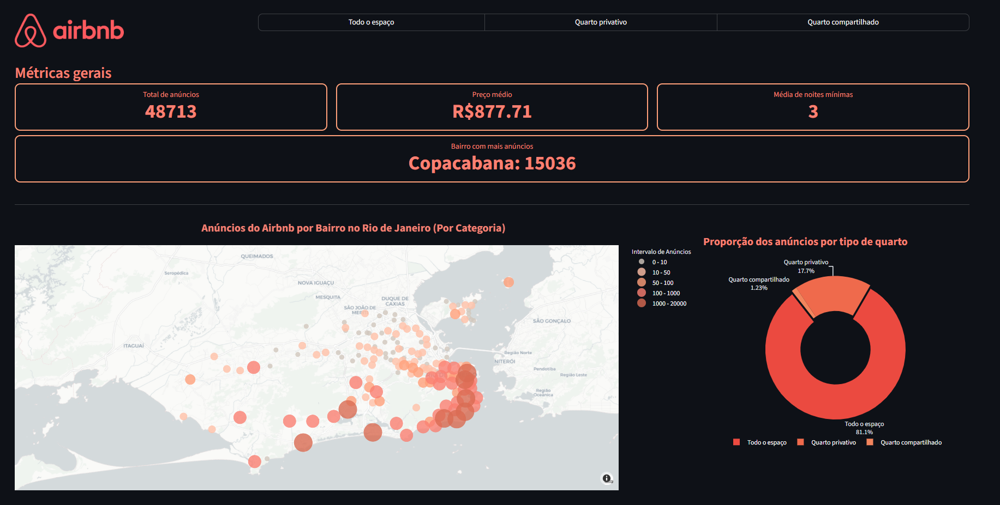

# Airbnb Listing Price & Rating Prediction

### Linguagens e Ferramentas:


Este repositório contém um pipeline completo de ciência de dados (*end-to-end*) focado na extração, limpeza de dados, análise exploratória (EDA), *benchmarking* geoespacial e modelagem preditiva multivariada para estimar **preços de diárias** do Airbnb utilizando **Aprendizado de Máquina** (*Machine Learning*). 

O fluxo do projeto abrange desde o tratamento de dados brutos da iniciativa *Inside Airbnb*, lidando com valores ausentes, remoção de *outliers* e engenharia de atributos espaciais, até o treinamento, validação cruzada e otimização de algoritmos de regressão e *boosting* (como Lasso, Decision Trees e XGBoost).

Além da camada analítica e preditiva, o projeto conta com um **[Dashboard Interativo no Streamlit](https://airbnb-felipe.streamlit.app/)** alimentado pelas bases de dados tratadas e estruturadas (`AirBnBLimpo*.csv`). Por seguirem um formato tabular limpo e padronizado, essas mesmas tabelas analíticas também podem ser facilmente integradas e exploradas em ferramentas de *Business Intelligence* (BI), como o **Power BI**, para a criação de relatórios gerenciais e análises visuais de mercado.

---

## 📂 Árvore de Diretórios

```
📂 Air-BnB
├── 📂 .devcontainer
│   └── 📄 devcontainer.json
├── 📂 data
│   ├── 📄 AirBnB_raw_selected_columns.csv
│   ├── 📄 AirBnBLimpo_Chicago.csv
│   ├── 📄 AirBnBLimpo_London.csv
│   ├── 📄 AirBnBLimpo_New-york-city.csv
│   └── 📄 AirBnBLimpo.csv
├── 📂 image
│   └── 📄 Airbnb-streamlit-photo.png
├── 📂 notebooks
│   ├── 📓 01_rio_de_janeiro_analysis.ipynb
│   ├── 📓 02_world_cities_analysis.ipynb
│   └── 📄 xgboost_world_London.joblib
├── 📂 src
├── 📄 .gitignore
├── 📄 README.md
├── 📄 app.py
└── 📄 requirements.txt
```

---

## Dashboard
<a href="https://airbnb-felipe.streamlit.app/" target="_blank">
  
</a>

---

## Escopo do Projeto
O pipeline analítico está dividido em dois ambientes de execução distintos:
- **Rio de Janeiro (Estudo Aprofundado):** Um estudo localizado analisando 48.713 registros brutos (~40.131 registros válidos após a limpeza). Inclui limpeza robusta de dados, remoção de outliers com teto de R$ 10.000, redução de multicolinearidade e recursos de avaliação de risco local (como métricas de segurança de bairros).
- **Cidades Globais:** Um pipeline generalizado construído para escalar por outras cidades ao redor do mundo (Londres, Nova York e Chicago), mantendo a estrutura analítica central.

---

## Principais Recursos e Engenharia de Atributos
- **Limpeza e Pré-processamento:** Tratamento de valores ausentes, filtragem direcionada de outliers e engenharia de recursos específica do domínio.
- **Recursos Geoespaciais e de Segurança:** Criação do indicador binário `bairro_perigoso` capturando sensibilidades de segurança pública e uso contínuo de coordenadas (`latitude`, `longitude`).
- **Seleção de Atributos e Controle de Redundância:** Exclusão de variáveis altamente colineares como `bedrooms` (priorizando `bathrooms` e `accommodates`) e remoção de `review_scores_rating` devido à alta assimetria e padrões MNAR (Missing Not at Random).

---

## Desempenho dos Modelos e Benchmarking (Rio de Janeiro)

### 1. Baseline Geoespacial (Apenas Coordenadas)
Para estabelecer uma régua comparativa inicial, os modelos foram treinados utilizando estritamente as coordenadas espaciais:
* **Dummy Regressor (Média):** $R^2 \approx 0.00$, MAE = R$ 487,92, RMSE = R$ 900,59
* **Lasso Regressor:** $R^2 = 0.0506$, MAE = R$ 465,19, RMSE = R$ 877,49
* **Decision Tree Regressor:** $R^2 = 0.1421$, MAE = R$ 436,42, RMSE = R$ 834,15
* **XGBoost Regressor:** $R^2 = 0.1531$, MAE = R$ 431,08, RMSE = R$ 828,80

### 2. Pipeline Multivariado (Com as Features Selecionadas)
A integração de atributos físicos (`bathrooms`, `accommodates`, `beds`), tipologias de quartos, bairros seguros e regras operacionais elevou significativamente o poder preditivo:
* **Lasso Regressor (Polinomial Grau 2):** $R^2 = 0.4319$, MAE = R$ 341,23, RMSE = R$ 658,60
* **Decision Tree Regressor (Otimizado via GridSearchCV):** $R^2 = 0.4618$, MAE = R$ 329,07, RMSE = R$ 641,00
* **XGBoost Regressor (Otimizado via GridSearchCV):** $R^2 = 0.5284$, MAE = R$ 301,13, RMSE = R$ 600,05

---

## Destaques de Importância das Features (XGBoost)
A análise de importância relativa dos atributos confirma uma hierarquia lógica consistente para o mercado imobiliário:
1. **`bathrooms` (~27%):** Atua como proxy direta de porte, luxo e padrão construtivo do imóvel.
2. **`room_type` (~16% para Todo o espaço):** O nível de privacidade estabelece a faixa de tarifa base.
3. **`accommodates` (~11%):** A capacidade máxima de hóspedes escala a precificação de forma dinâmica.
4. **`number_of_reviews`, `longitude`, `latitude` (~17% combinados):** A tração comercial e as coordenadas espaciais refinam o valor de mercado local.

---

## Testes de Desempenho e Carga (AWS Lambda)

O modelo XGBoost global foi implantado como uma função *serverless* no **AWS Lambda** e submetido a um teste de carga utilizando o **Locust** para avaliar seu comportamento, vazão (*throughput*) e latência sob tráfego contínuo.

O pipeline de inferência carrega o modelo treinado utilizando `joblib` dentro do ambiente Lambda.

### Configuração de Teste e Ambiente

* **Infraestrutura:** AWS Lambda
* **Empacotamento de Implantação:** Modelo XGBoost treinado carregado via `joblib`
* **Ferramenta de Teste de Carga:** Locust
* **Usuários Simulados:** 20 usuários concorrentes no máximo
* **Taxa de Criação (*Spawn Rate*):** 2 usuários/segundo

---

### Resultados do Teste de Carga e Métricas

O pipeline lidou com sucesso com o tráfego contínuo com **zero falhas** sob a carga simulada. Abaixo estão os principais indicadores de desempenho extraídos da execução do teste:

#### Estatísticas de Requisições

| Tipo | Endpoint | Total de Requisições | Falhas | Latência Média | Latência Mínima | Latência Máxima (Cold Start) | Vazão (RPS) |
| --- | --- | --- | --- | --- | --- | --- | --- |
| **POST** | `/predict` | **5.582** | **0** | **57,79 ms** | **31 ms** | **4.601 ms** | **9,67 req/s** |

#### Percentis de Tempo de Resposta (Distribuição de Latência)

| 50% (Mediana) | 60% | 70% | 80% | 90% | 95% | 99% | 100% ($p_{100}$) |
| --- | --- | --- | --- | --- | --- | --- | --- |
| **43 ms** | 46 ms | 50 ms | 56 ms | 81 ms | 110 ms | 130 ms | **4.600 ms** |

---

### Principais Descobertas e Insights de Produção

1. **Latência Ultra-Baixa em Estado Estacionário:** Em condições de estado estacionário, o modelo demonstra um desempenho excepcional. A latência mediana ($p_{50}$) é de apenas **43 ms** e, mesmo no percentil 99 ($p_{99}$), o tempo de resposta permanece baixo em **130 ms**.
2. **O Fenômeno do Cold Start (Inicialização Fria):** A latência máxima registrada atingiu **4,6 segundos** ($p_{100}$). Conforme demonstrado claramente no gráfico de *Tempos de Resposta*, este foi um pico isolado bem no início da janela de teste, correspondendo diretamente ao provisionamento inicial do contêiner AWS Lambda (Cold Start) e ao custo de carregamento do modelo `joblib` na memória.
3. **Alta Confiabilidade:** O sistema manteve uma sólida **taxa de sucesso de 100%** (0 falhas em 5.582 requisições) durante toda a duração do teste, mantendo uma vazão estável de ~9,67 RPS com 20 usuários concorrentes.

### Mitigação em Produção para Escala

Em um cenário de produção em grande escala (semelhante ao Airbnb), a latência de Cold Start de 4,6 segundos observada no nível $p_{100}$ seria totalmente mitigada aproveitando o recurso **AWS Provisioned Concurrency** (mantendo instâncias Lambda aquecidas e inicializadas) ou migrando o pipeline de inferência em contêiner para um cluster **Kubernetes (EKS)** com nós sempre ativos. Este ajuste arquitetural garante uma latência inferior a 150 ms para 100% dos usuários finais.

---

## Trabalho em Andamento:

O pipeline está sendo expandido no momento para lidar com a previsão de avaliações de usuários. A próxima fase fará o benchmarking do desempenho de:

1. **Modelos de Regressão** (prevendo pontuações contínuas exatas de avaliação).
2. **Modelos de Classificação Multiclasse** (prevendo faixas/níveis de avaliação).

Além disso, está em desenvolvimento um trabalho tambem de:
3. **Modelos de Recomendação de Quarto** (recomendação semântica de quartos utilizando modelos baseados na arquitetura Transformer).